# macro_risk — Live Macro Driven Risk & Direction Engine

C++17 production-grade engine that fetches **live macro data** (CPI, PPI,
Core PCE, NFP, FOMC, Unemployment, GDP, Retail Sales, ISM, UMich) and
produces direction probabilities, confidence intervals, VaR/ES, GARCH vol,
walk-forward backtests, multi-asset portfolio risk and stress replays for
every user-configured asset (equity / ETF / bond / crypto / commodity / FX).

Ships as a CLI, a REST/Prometheus server, and a Docker container; persists
runs to JSON files or Postgres; alerts to Slack; exports text / JSON / CSV /
HTML / model-card.

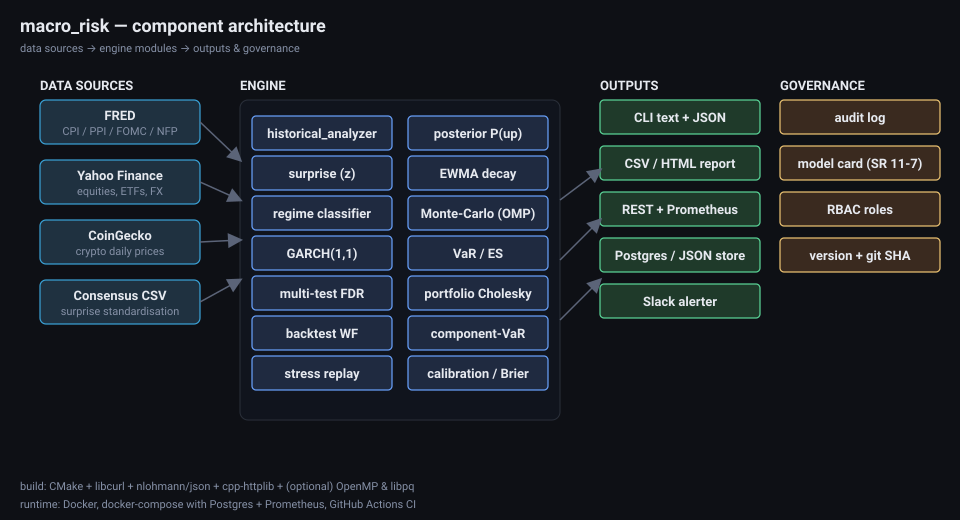

---

## Visual tour of every module

> All visualisations below are **mockups** that mirror the actual outputs the
> engine produces. They show what each module returns; rendering uses the
> same dark palette as the standalone HTML report.

### 1. Direction forecast — empirical · EWMA-weighted · regime-conditional

For every (asset × upcoming event) the engine emits three posterior
probabilities of "up" along with the empirical 95% CI and the BH-q
multiple-testing-adjusted significance.

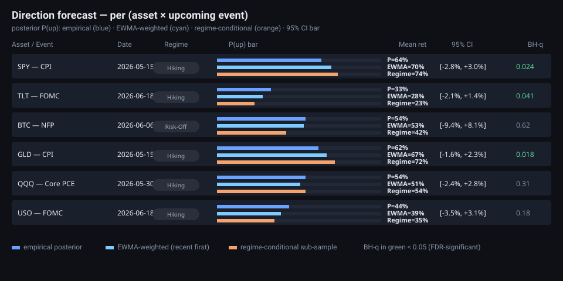

### 2. Monte-Carlo terminal-price fan

Day-1 shock drawn from the event-conditional empirical return distribution,
days 2..N drift sampled from the unconditional baseline. 20 000 paths,
parallelised with OpenMP.

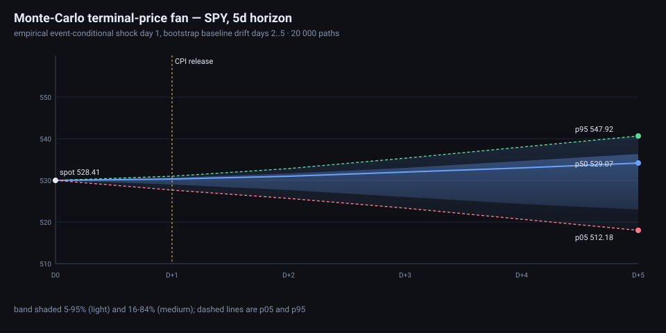

### 3. GARCH(1,1) conditional volatility

MLE fitted via Nelder-Mead with feasibility penalties; falls back to
RiskMetrics (λ=0.94) on convergence failure. The 1-step-ahead σ is reported
per asset and feeds the per-event risk band.

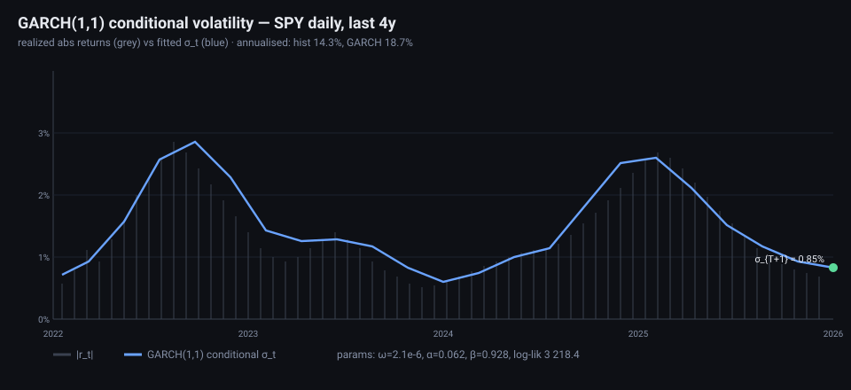

### 4. Macro regime timeline

Rule-based classifier driven by CPI YoY, Fed Funds, Unemployment, VIX and
SPY 3-month drawdown. Used to carve out a regime-conditional sub-sample of
historical event reactions.

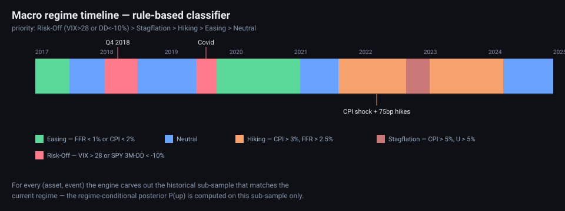

### 5. Multiple-testing correction (Bonferroni & BH-FDR)

When you screen 13 assets × 8 event kinds you get 100+ p-values: most
"signals" you'd accept at α=0.05 are pure noise. The engine adjusts every
sign-test p across the full grid.

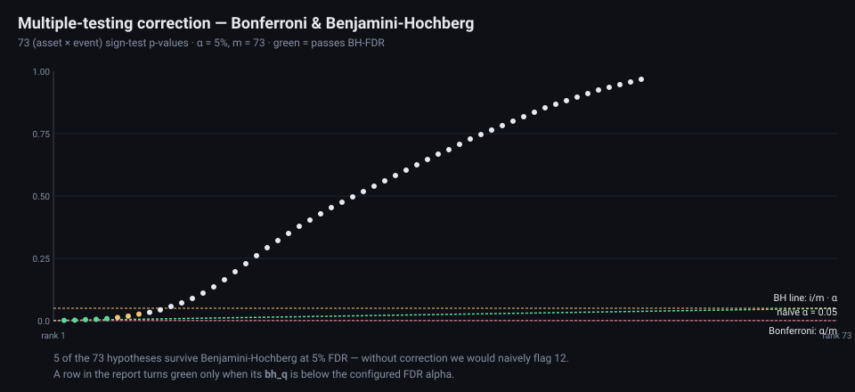

### 6. Calibration / reliability diagram

Walk-forward forecasts are scored against realised outcomes via Brier-score,
log-loss and a reliability diagram. The same loop emits the directional
PnL Sharpe / Sortino / max-DD.

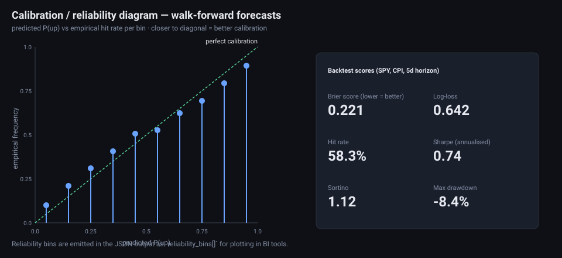

### 7. EWMA time-decay weighting

`weight = exp(-ln(2) · age / half_life)`. Recent history gets more weight
in both the posterior P(up) and the weighted mean / weighted quantile.

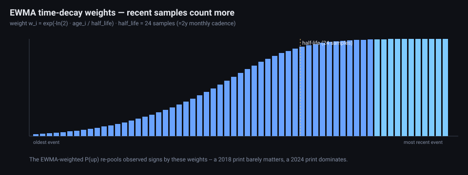

### 8. Portfolio risk — VaR/CVaR + component-VaR + correlation

Empirical covariance → Cholesky → multi-asset Monte-Carlo → portfolio
P&L distribution. Component-VaR via finite-difference per holding.

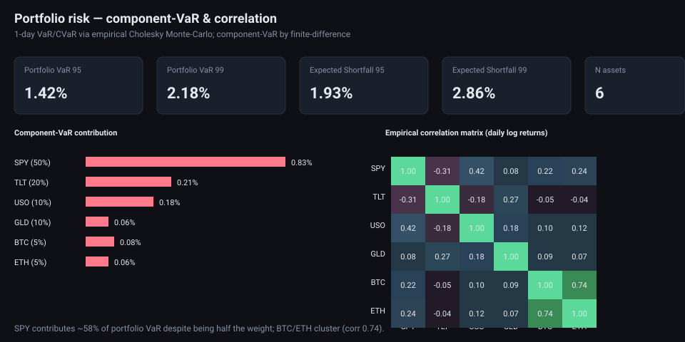

### 9. Historical stress replays

Library of nine canonical macro stress windows (GFC, Euro, Taper, Volmageddon,
Q4-2018, Covid, 2022 CPI shock, SVB, China devaluation). Each asset's own
price path is replayed through each window — no synthetic shocks.

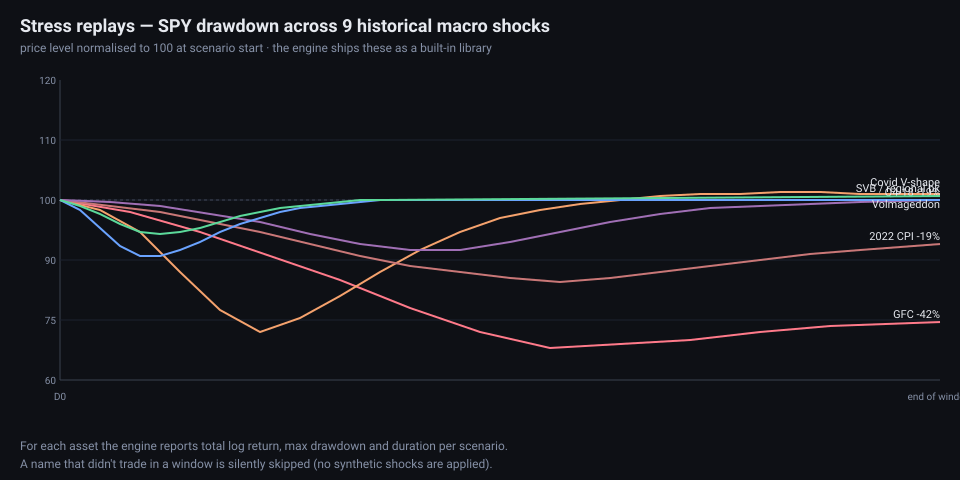

### 10. Walk-forward backtest PnL

For each historical event, build the forecast using only data strictly
before it; size = `|P(up) - 0.5| · 2`, sign = direction. Aggregates to a
cumulative PnL curve with max-DD shading.

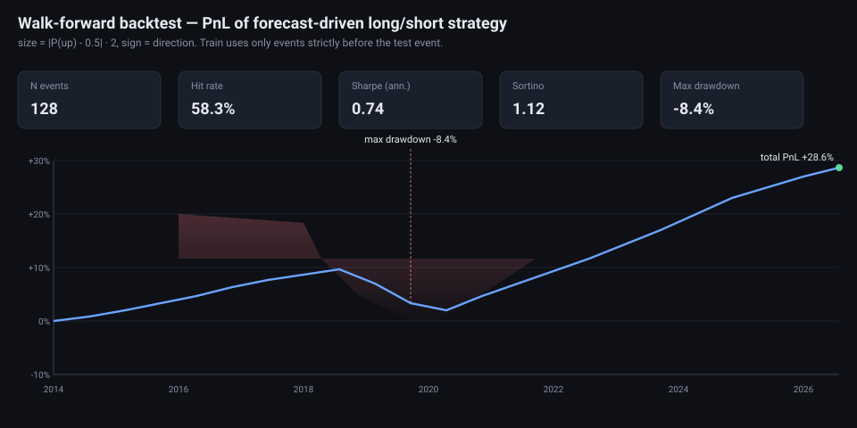

### 11. Standalone HTML report

`--html report.html` renders the full ScanOutput as a self-contained dark
HTML page with no external assets. Good for pinning to Confluence / SharePoint
or e-mailing.

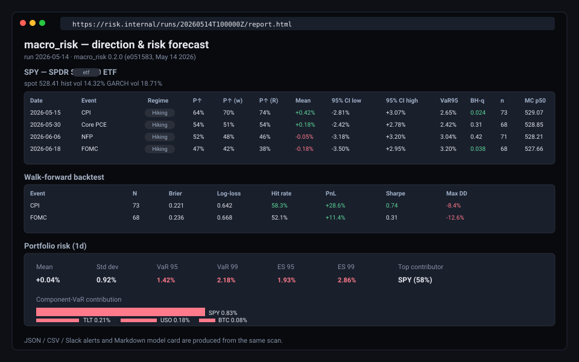

### 12. REST API + Prometheus metrics

`--serve` launches a cpp-httplib server with `/healthz`, `/version`,
`/metrics`, `/runs`, `/runs/{id}`, `/scan`. Optional bearer-token auth.

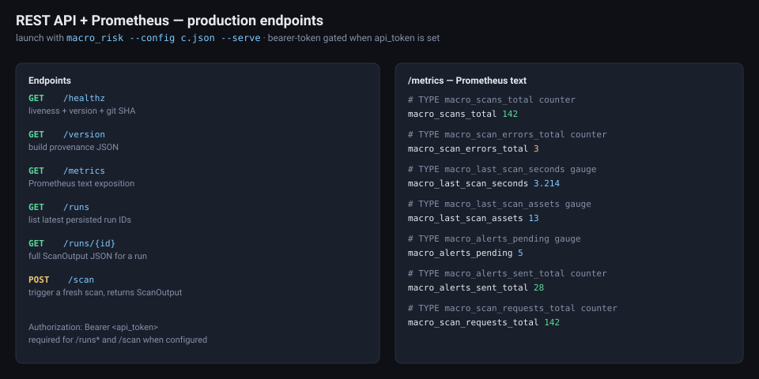

### 13. Governance — audit, RBAC, model card

Append-only JSON-lines audit log, RBAC defaults (viewer / analyst / admin)
and an SR 11-7-aligned Markdown model card generated alongside every run.

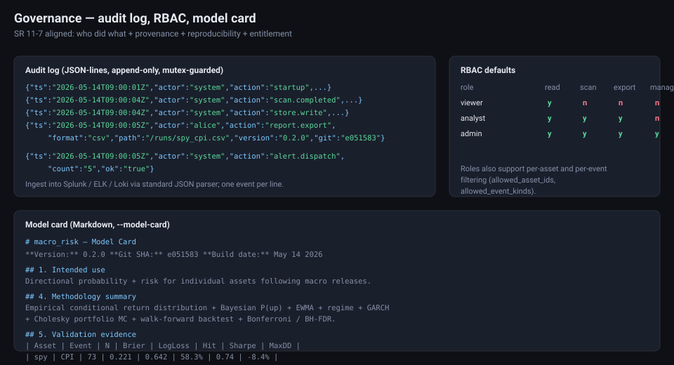

---

## Features at a glance

### Analytics
- Empirical, EWMA-weighted, and regime-conditional Bayesian P(up)
- 68% / 95% empirical confidence intervals, historical VaR, Expected Shortfall
- GARCH(1,1) MLE volatility forecast per asset
- Walk-forward backtest (Brier, log-loss, hit-rate, Sharpe, Sortino, max-DD)
- Multi-asset portfolio Cholesky Monte-Carlo + finite-difference component VaR
- Nine historical stress replays (GFC, Euro, Taper, Volmageddon, Covid,
  2022-CPI, SVB, ...)
- Bonferroni and Benjamini-Hochberg FDR correction across the full grid
- Rule-based macro regime detector (Easing / Hiking / Stagflation / Risk-Off)
- Standardised release surprise (z-score) from pluggable consensus feed
- OpenMP-parallel Monte-Carlo (auto-detected at build time)

### Production
- REST API (`/healthz`, `/version`, `/metrics`, `/scan`, `/runs`, `/runs/{id}`)
- Bearer-token authentication (optional)
- Prometheus text-format `/metrics` endpoint with built-in counters / gauges
- Persistent run storage: JSON files or Postgres (libpq, optional at build time)
- Append-only audit log (JSON-lines, SIEM friendly)
- Structured JSON logger for cloud-native log shippers
- Thread-pool primitive for parallel data fetching
- Git SHA + semver + build-date baked into the binary

### Reporting
- Console table, JSON, long-form CSV, standalone HTML, Markdown model card
- Slack webhook alerts gated by P(up) and BH-q thresholds

### Governance
- SR 11-7 aligned model card generator
- RBAC role/permission API (viewer / analyst / admin)
- Versioned, reproducible run-ids
- Audit trail with actor / action / fields

---

## Build

```bash
sudo apt-get install -y cmake build-essential libcurl4-openssl-dev libpq-dev
cmake -S . -B build -DCMAKE_BUILD_TYPE=Release -DBUILD_TESTS=ON
cmake --build build -j
ctest --test-dir build --output-on-failure
```

If `libpq` is missing the Postgres backend is skipped at configure time and
the JSON store is used. If OpenMP is missing the Monte-Carlo loops run
serially. Both adjustments are logged at CMake configure time.

## Docker

```bash
docker compose up --build              # macro_risk + Postgres
docker compose --profile observability up   # adds Prometheus on :9090
```

The default compose stack mounts `config.example.json` and exposes the
REST/Prometheus endpoints on `:8080`.

---

## CLI

```bash
./build/macro_risk --init my_config.json          # write skeleton
./build/macro_risk --config my_config.json        # text report
./build/macro_risk --config my_config.json --json
./build/macro_risk --config my_config.json --csv  out.csv
./build/macro_risk --config my_config.json --html out.html
./build/macro_risk --config my_config.json --model-card MODEL_CARD.md
./build/macro_risk --config my_config.json --persist --alert
./build/macro_risk --config my_config.json --serve     # REST server
./build/macro_risk --version
```

Environment overrides:
- `FRED_API_KEY`   – overrides `api_keys.fred`
- `SLACK_WEBHOOK`  – overrides `alerts.slack_webhook`
- `POSTGRES_DSN`   – overrides `persistence.postgres_dsn`

---

## REST API

| Method | Path             | Description                                     |
|--------|------------------|-------------------------------------------------|
| GET    | `/healthz`       | Liveness check with build metadata              |
| GET    | `/version`       | Engine semver + git SHA + build date            |
| GET    | `/metrics`       | Prometheus text-format metrics                  |
| GET    | `/runs`          | List recent persisted run IDs                   |
| GET    | `/runs/{id}`     | Load full ScanOutput JSON for a run             |
| POST   | `/scan`          | Trigger a fresh scan, return JSON ScanOutput    |

All non-health endpoints honour `Authorization: Bearer <api_token>` if
`server.api_token` is set.

---

## Persistence

The `persistence` config section picks between:

```json
"persistence": {"backend": "json",     "json_dir": ".cache/runs"}
"persistence": {"backend": "postgres", "postgres_dsn": "host=db user=macro ..."}
```

Postgres schema is shipped in `schema/postgres.sql` and applied automatically
by `docker compose` via `docker-entrypoint-initdb.d`. The store gracefully
falls back to JSON if `libpq` is unavailable or the connection fails.

---

## Alerts

```json
"alerts": {
  "enabled": true,
  "slack_webhook": "",
  "prob_threshold": 0.20,
  "bh_q_threshold": 0.10,
  "min_sample_size": 20
}
```

`--alert` fires for every `(asset, upcoming event)` where the empirical
posterior P(up) is more than `prob_threshold` away from 50/50 AND the BH-q
adjusted p-value is below `bh_q_threshold` AND the sample size is at least
`min_sample_size`. Slack messages are sent via incoming webhook.

---

## Governance

- `--model-card MODEL_CARD.md` emits a Markdown model card with intended
  use, inputs, methodology, validation evidence, limitations and
  reproducibility section.
- The append-only audit log writes one JSON object per action to
  `audit.path`. Recorded actions include `startup`, `scan.completed`,
  `server.start`, `store.write`, `report.export`, `alert.dispatch`,
  `model_card.write`.
- `Rbac` exposes viewer / analyst / admin defaults; map your SSO group
  claims to those role names in a downstream gateway.

---

## Project layout

```
src/
  util/          http_client, time, logger, json_logger, thread_pool,
                 holiday_calendar, version
  data/          FRED, Yahoo, CoinGecko, econ-calendar, price cache,
                 consensus provider
  engine/        historical_analyzer, statistical_engine, monte_carlo,
                 risk_calculator, surprise, garch, regime, multitest,
                 calibration, linalg, portfolio_risk, stress, backtest,
                 scanner
  persist/       Store interface + json_store + (optional) postgres_store
  server/        metrics + http_server (cpp-httplib)
  alerts/        slack_alerter + rules
  governance/    audit_log + model_card + rbac
  report/        text + JSON + CSV + HTML reporters
  main.cpp       CLI
tests/           statistics + advanced + production tests
schema/          Postgres schema
deploy/          Prometheus scrape config
docs/images/     SVG mockups embedded in this README
Dockerfile, docker-compose.yml
.github/workflows/ci.yml
config.example.json
```

## License

MIT.
